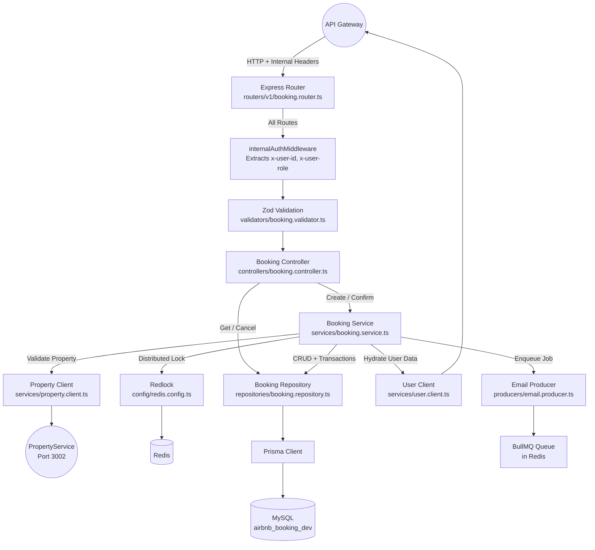

# Booking Service

The Booking Service is the core transactional engine of the platform. It manages the complete lifecycle of a reservation: creation with distributed locking, confirmation with ACID-compliant idempotency, retrieval, and cancellation. It also acts as the producer for asynchronous notification events.

This service is never exposed to external clients. It receives requests exclusively from the API Gateway (`UserService`) and trusts the identity information (`x-user-id`, `x-user-role`, `x-correlation-id`) injected in the request headers.

---

## Request Flow Architecture



---

## Folder Structure

```
BookingService/
  src/
    config/            # Zod-validated env config, Redis/Redlock setup, Winston logger
    controllers/       # HTTP handlers: createBooking, confirmBooking, getById, getUserBookings, cancel
    dto/               # TypeScript interfaces (CreateBookingDTO, NotificationDto)
    middlewares/       # internalAuthMiddleware (trusts gateway headers), error handler
    prisma/
      schema.prisma    # Booking and IdempotencyKey models
      generated/       # Auto-generated Prisma client
      client.ts        # Singleton Prisma client instance
    producers/         # BullMQ job producer (addEmailToQueue)
    queues/            # BullMQ queue instance configuration
    repositories/      # All database queries: CRUD, overlapping check, FOR UPDATE locks
    routers/
      v1/              # Versioned route definitions
    services/          # Core business logic, property.client, user.client
    utils/
      errors/          # AppError class hierarchy
      helpers/         # AsyncLocalStorage for correlationId
    validators/        # Zod schemas for request validation
```

---

## ACID Compliance and Concurrency Control

### The Problem

In a booking system, two fundamental race conditions must be prevented:

1. **Two users booking the same property for overlapping dates simultaneously.** Without protection, both requests pass the availability check, both insert a row, and both succeed -- resulting in a double booking.
2. **A single user clicking "Confirm" twice rapidly.** Without protection, the confirmation handler runs twice in parallel, potentially charging the user twice or creating inconsistent state.

### Solution 1: Distributed Locking with Redlock

When `createBookingService` is called, it constructs a lock resource:

```
property:{propertyId}:{checkInDate}:{checkOutDate}
```

It acquires an exclusive lock on this resource using `Redlock` (distributed mutual exclusion over Redis). The lock has a configurable TTL (`LOCK_TTL` environment variable, default 60 seconds).

The critical section after lock acquisition performs a **second** overlapping-bookings check against the database. This double-check pattern ensures correctness even if the initial (pre-lock) check passes due to interleaving:

```
1. Pre-lock check       -> passes (no conflicts yet)
2. Acquire Redlock      -> blocks concurrent requests
3. Post-lock check      -> passes (still no conflicts)
4. INSERT booking       -> committed
5. Release lock
```

If step 3 finds a conflict (because another request just committed before the lock was acquired), the request is rejected with a `400 Bad Request`.

### Solution 2: Idempotency Keys with Pessimistic Row Locks

The booking confirmation flow uses Prisma's `$transaction` API to execute an interactive transaction:

1. `SELECT * FROM IdempotencyKey WHERE idemKey = ? FOR UPDATE` -- acquires a row-level exclusive lock
2. Check if the key exists and is not yet finalized
3. `UPDATE Booking SET status = 'CONFIRMED'`
4. `UPDATE IdempotencyKey SET finalized = true`
5. Commit

The `FOR UPDATE` clause ensures that if two concurrent confirm requests arrive for the same idempotency key, the second one blocks at step 1 until the first transaction completes. By the time it reads the row, `finalized` is already `true`, and the request is rejected with `400 Booking already finalized`.

### Database Schema (Prisma)

```prisma
model Booking {
  id              Int             @id @default(autoincrement())
  userId          Int
  propertyId      Int
  checkInDate     DateTime
  checkOutDate    DateTime
  numberOfNights  Int
  bookingAmount   Float
  status          BookingStatus   @default(PENDING)
  totalGuests     Int
  idempotencyKey  IdempotencyKey?
  createdAt       DateTime        @default(now())
  updatedAt       DateTime        @updatedAt
}

model IdempotencyKey {
  id        Int      @id @default(autoincrement())
  IdemKey   String   @unique
  finalized Boolean  @default(false)
  booking   Booking? @relation(fields: [bookingId], references: [id])
  bookingId Int?     @unique
  createdAt DateTime @default(now())
  updatedAt DateTime @updatedAt
}

enum BookingStatus {
  PENDING
  CONFIRMED
  CANCELLED
}
```

---

## Notification Integration

After a booking is confirmed, the service hydrates user and property data via HTTP calls to the `UserService` and `PropertyService`, then enqueues a BullMQ job:

```typescript
await addEmailToQueue({
    to: user.email,
    subject: "Your Booking is Confirmed!",
    templateId: "booking_confirmation",
    params: {
        userName: user.firstName,
        propertyName: property.name,
        checkIn: booking.checkInDate,
        checkOut: booking.checkOutDate,
        bookingAmount: booking.bookingAmount
    },
    correlationId: getCorrelationId()
});
```

The `correlationId` is passed through the queue payload so the `NotificationService` worker can trace the email dispatch back to the original HTTP request.

---

## API Reference

Base URL: `http://localhost:3001` (internal only, accessed via gateway)

All routes are prefixed with `/api/v1/bookings` and require the `internalAuthMiddleware` (expects `x-user-id` header).

### Route Summary

**Bookings** (`/api/v1/bookings`)

| Method | Endpoint | Auth | Description |
|---|---|---|---|
| `POST` | `/api/v1/bookings` | Internal (`x-user-id`) | Create booking, acquire distributed lock |
| `POST` | `/api/v1/bookings/confirm/:idempotencyKey` | Internal (`x-user-id`) | Confirm with `SELECT ... FOR UPDATE` transaction |
| `GET` | `/api/v1/bookings/:id` | Internal (`x-user-id`) | Fetch a single booking by ID |
| `GET` | `/api/v1/bookings/user/:userId` | Internal (`x-user-id`, Owner/ADMIN) | Fetch all bookings for a user |
| `POST` | `/api/v1/bookings/cancel/:id` | Internal (`x-user-id`, Owner/ADMIN) | Cancel a booking |

---

#### `POST /api/v1/bookings`

Create a new booking. Acquires a distributed lock, validates the property exists and is active, checks date availability, and inserts the booking with `PENDING` status.

**Headers Required**: `x-user-id`, `x-user-role`, `x-correlation-id`

**Request Body**:
```json
{
  "userId": 1,
  "propertyId": 5,
  "totalGuests": 2,
  "bookingAmount": 900.00,
  "checkInDate": "2026-09-01T12:00:00.000Z",
  "checkOutDate": "2026-09-03T12:00:00.000Z"
}
```

**Validation Rules** (Zod):
- `userId`: Positive integer
- `propertyId`: Positive integer
- `totalGuests`: Integer >= 1 (defaults to 1)
- `bookingAmount`: Positive number
- `checkInDate`, `checkOutDate`: ISO 8601 datetime strings

**Response** (`201 Created`):
```json
{
  "success": true,
  "message": "Booking created successfully. Use the idempotency key to confirm.",
  "data": {
    "bookingId": 12,
    "idempotencyKey": "a3f1b2c4-d5e6-7890-abcd-ef1234567890"
  }
}
```

---

#### `POST /api/v1/bookings/confirm/:idempotencyKey`

Confirm a pending booking. Runs inside a database transaction with `SELECT ... FOR UPDATE` on the idempotency key row. On success, triggers an asynchronous email notification via BullMQ.

**Headers Required**: `x-user-id`, `x-user-role`, `x-correlation-id`

**Response** (`200 OK`):
```json
{
  "success": true,
  "message": "Booking confirmed successfully",
  "data": {
    "id": 12,
    "userId": 1,
    "propertyId": 5,
    "status": "CONFIRMED",
    "checkInDate": "2026-09-01T12:00:00.000Z",
    "checkOutDate": "2026-09-03T12:00:00.000Z",
    "bookingAmount": 900.00,
    "numberOfNights": 2
  }
}
```

**Error Cases**:
- `404` - Idempotency key not found
- `400` - Key not associated with a booking, or booking already finalized

---

#### `GET /api/v1/bookings/:id`

Fetch a single booking by its database ID.

**Headers Required**: `x-user-id`, `x-user-role`

**Response** (`200 OK`):
```json
{
  "success": true,
  "message": "Booking fetched successfully",
  "data": { ... }
}
```

---

#### `GET /api/v1/bookings/user/:userId`

Fetch all bookings for a specific user. Authorization is enforced at the controller level: the requesting user's `x-user-id` must match the `:userId` parameter, unless `x-user-role` is `ADMIN`.

**Headers Required**: `x-user-id`, `x-user-role`

**Response** (`200 OK`):
```json
{
  "success": true,
  "message": "User bookings fetched successfully",
  "data": [ ... ]
}
```

**Error Cases**:
- `403` - Access denied (non-admin trying to view another user's bookings)

---

#### `POST /api/v1/bookings/cancel/:id`

Cancel an existing booking. Ownership is validated: only the booking owner or an ADMIN can cancel.

**Headers Required**: `x-user-id`, `x-user-role`

**Response** (`200 OK`):
```json
{
  "success": true,
  "message": "Booking cancelled successfully",
  "data": {
    "id": 12,
    "status": "CANCELLED"
  }
}
```

**Error Cases**:
- `404` - Booking not found
- `403` - Access denied

---

## Environment Variables

| Variable | Required | Default | Description |
|---|---|---|---|
| `PORT` | No | `3001` | Server port |
| `DATABASE_URL` | Yes | - | MySQL connection string for Prisma |
| `REDIS_SERVER_URL` | No | `redis://localhost:6379` | Redis connection URL |
| `LOCK_TTL` | No | `5000` | Distributed lock TTL in milliseconds |