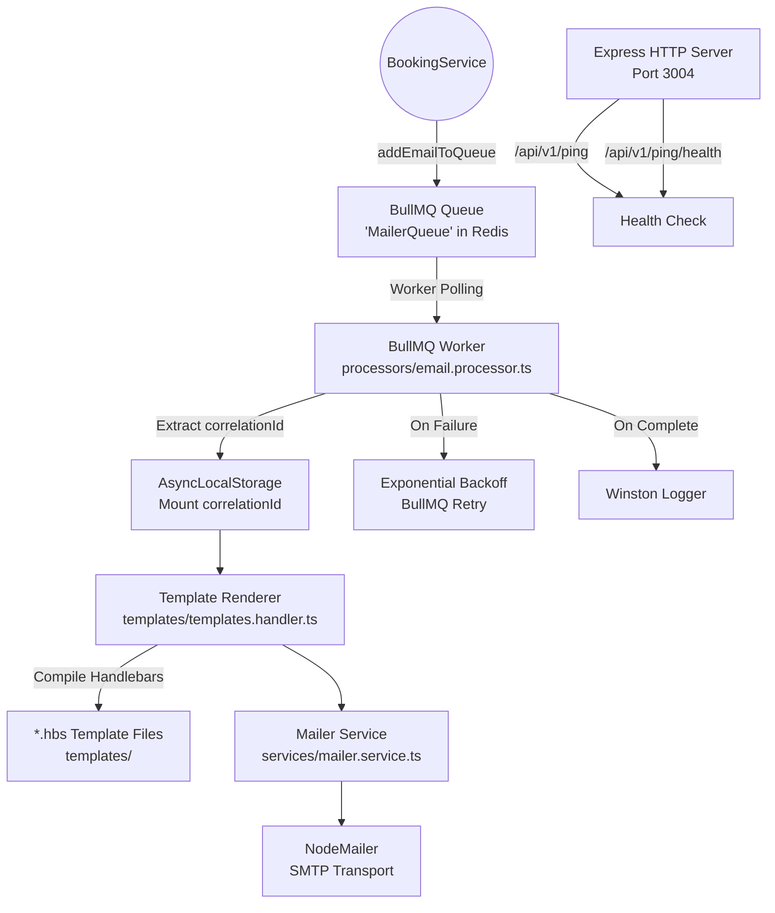

# Notification Service

The Notification Service is an asynchronous background worker that processes email dispatch jobs from a Redis-backed BullMQ queue. It operates entirely off the critical request path, ensuring that slow or failing external SMTP calls never block or degrade the booking confirmation flow.

This service does not receive direct HTTP requests from the API Gateway. Its primary input is the BullMQ job queue populated by the `BookingService`.

---

## Architecture



---

## Folder Structure

```
NotificationService/
  src/
    config/            # Zod-validated env config, Redis connection, Winston logger
    controllers/       # Ping controller for health checks
    dto/               # NotificationDto interface (to, subject, templateId, params, correlationId)
    middlewares/       # Correlation middleware, error handler
    processors/        # BullMQ worker definition and job processing logic
    producers/         # Queue name constants (MAILER_PAYLOAD)
    queues/            # BullMQ queue instance (MailerQueue)
    routers/
      v1/              # Health check routes
      v2/              # Reserved for future versioned routes
    services/          # NodeMailer transporter and sendEmail function
    templates/         # Handlebars (.hbs) email templates and template renderer
    utils/
      helpers/         # AsyncLocalStorage for correlationId
    validators/        # Zod schemas (if any)
```

---

## How It Works

### Decoupling via Message Queue

The `BookingService` never calls the `NotificationService` directly over HTTP. Instead, after a booking is confirmed, the `BookingService` enqueues a job:

```typescript
// In BookingService: producers/email.producer.ts
await mailerQueue.add("payload:mail", {
    to: user.email,
    subject: "Your Booking is Confirmed!",
    templateId: "booking_confirmation",
    params: { userName, propertyName, checkIn, checkOut, bookingAmount },
    correlationId: getCorrelationId()
});
```

This means:
- The booking confirmation HTTP response returns immediately, without waiting for the email to send.
- If the SMTP server is down, the booking is still confirmed. The email job sits in the queue and retries automatically via BullMQ's exponential backoff.
- The `NotificationService` can be scaled independently by running additional worker instances that all consume from the same Redis queue.

### Job Processing Pipeline

When the BullMQ worker picks up a job, the processing pipeline is:

1. **Validate Job Name** - Only jobs with name `payload:mail` are processed. Unknown job types throw an error.
2. **Mount Correlation ID** - The `correlationId` from the job payload is injected into Node.js `AsyncLocalStorage`. All subsequent log lines within this job execution automatically include the correlation ID.
3. **Render Template** - The `templateId` (e.g., `booking_confirmation`) is used to locate a Handlebars `.hbs` file. The `params` object is injected into the template to produce the final HTML email body.
4. **Send Email** - The rendered HTML is passed to NodeMailer, which dispatches it via the configured SMTP transport.
5. **Log Result** - On success, a completion log is emitted. On failure, an error log is emitted with the job ID and error message.

### Distributed Tracing

The `correlationId` is the key to tracing a user's booking flow across all four services:

```
Client Request -> API Gateway (generates correlationId)
  -> BookingService (receives via x-correlation-id header)
    -> BullMQ Queue (correlationId embedded in job payload)
      -> NotificationService Worker (extracts and mounts into AsyncLocalStorage)
```

Every Winston log line emitted by the worker includes this ID, making it possible to filter logs across all services by a single value and reconstruct the complete lifecycle of a request.

---

## API Reference

The Notification Service exposes minimal HTTP endpoints. Its primary function is as a background worker, not a REST API server.

Base URL: `http://localhost:3004`

---

#### `GET /api/v1/ping`

Basic liveness probe.

**Auth Required**: None

**Response** (`200 OK`): Pong response

---

#### `GET /api/v1/ping/health`

Health check endpoint.

**Auth Required**: None

**Response** (`200 OK`): `OK`

---

## Environment Variables

| Variable | Required | Default | Description |
|---|---|---|---|
| `PORT` | No | `3004` | HTTP server port |
| `REDIS_HOST` | No | `localhost` | Redis server hostname |
| `REDIS_PORT` | No | `6379` | Redis server port |
| `MAILER_USER` | Yes | - | SMTP username / email address |
| `MAILER_PASS` | Yes | - | SMTP password / app password |