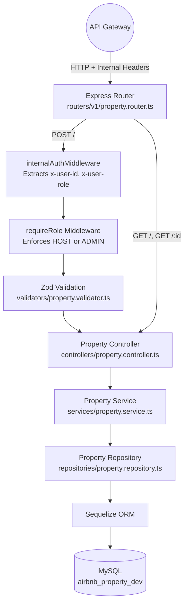

# Property Service

The Property Service is a dedicated microservice responsible for managing property listings. It handles creation, retrieval, and enforces role-based access control to ensure only authorized users (hosts and admins) can create or modify listings.

This service is not exposed to external clients. It receives traffic from the API Gateway (`UserService`) and from the `BookingService` (which queries property details during the booking validation flow).

---

## Request Flow Architecture



---

## Folder Structure

```
PropertyService/
  src/
    config/            # Zod-validated env config, Sequelize setup, Winston logger
    controllers/       # HTTP handlers: createProperty, getProperties, getPropertyById
    db/
      migrations/      # Sequelize migration files (Property, Address tables)
      models/          # Sequelize model definitions
      seeders/         # Database seed scripts
    dto/               # TypeScript interfaces (CreatePropertyDTO)
    middlewares/       # internalAuthMiddleware, requireRole, error handler
    repositories/      # Data access layer (Sequelize queries)
    routers/
      v1/              # Versioned route definitions
    services/          # Business logic layer
    types/             # Shared TypeScript type declarations
    utils/
      errors/          # AppError class hierarchy
      helpers/         # AsyncLocalStorage for correlationId
    validators/        # Zod schemas for request validation
```

---

## Role-Based Access Control

Property creation is a privileged operation. The middleware chain for `POST /` enforces this in three steps:

1. **`internalAuthMiddleware`** - Extracts `x-user-id` and `x-user-role` from the incoming request headers (injected by the API Gateway after JWT verification). If `x-user-id` is missing, the request is rejected with `401 Unauthorized`.

2. **`requireRole(['HOST', 'ADMIN'])`** - Checks that the extracted role is either `HOST` or `ADMIN`. If the user is a `GUEST`, the request is rejected with `403 Forbidden`.

3. **`hostId` Injection** - The controller takes the authenticated `userId` from the request and injects it as `hostId` into the request body before passing it to the service layer. This prevents a malicious client from setting an arbitrary `hostId` in the request body.

The `GET` routes are public and do not require any authentication, since property listings are meant to be browsable by anyone.

---

## SOLID Principles in Practice

- **Single Responsibility**: The controller handles HTTP concerns only (parsing params, formatting responses). The service layer contains business logic (e.g., checking if a property exists). The repository layer handles all Sequelize queries.
- **Open/Closed**: Adding a new query (e.g., "get properties by city") requires only a new repository function and a new route, without modifying existing code.
- **Dependency Inversion**: The controller calls `createPropertyService(data)` without knowing whether the data is stored in MySQL, PostgreSQL, or a flat file. The storage implementation is encapsulated in the repository.

---

## API Reference

Base URL: `http://localhost:3002` (internal only, accessed via gateway)

All routes are prefixed with `/api/v1/properties`.

### Route Summary

**Properties** (`/api/v1/properties`)

| Method | Endpoint | Auth | Description |
|---|---|---|---|
| `POST` | `/api/v1/properties` | Internal (`x-user-id`, HOST/ADMIN) | Create a new property listing |
| `GET` | `/api/v1/properties` | None (public) | List all property listings |
| `GET` | `/api/v1/properties/:id` | None (public) | Get a single property by ID |

**Health** (`/api/v1/ping`)

| Method | Endpoint | Auth | Description |
|---|---|---|---|
| `GET` | `/api/v1/ping` | None | Liveness probe |

---

#### `POST /api/v1/properties`

Create a new property listing. Requires internal authentication and HOST/ADMIN role.

**Headers Required**: `x-user-id`, `x-user-role`

**Middleware Chain**: `internalAuthMiddleware` -> `requireRole(['HOST', 'ADMIN'])` -> `validateRequestBody(createPropertySchema)`

**Request Body**:
```json
{
  "name": "Oceanfront Villa",
  "description": "A beautiful villa on the beach",
  "address": "123 Beach Road",
  "city": "Miami",
  "state": "Florida",
  "country": "USA",
  "latitude": 25.7617,
  "longitude": -80.1918,
  "pricePerNight": 450.00,
  "maxGuests": 6,
  "amenities": ["wifi", "pool", "parking"],
  "images": ["https://example.com/villa1.jpg"]
}
```

**Validation Rules** (Zod):
- `name`: Required, non-empty string
- `description`: Optional string
- `address`: Required, non-empty string
- `city`: Required, non-empty string
- `state`: Optional string
- `country`: Required, non-empty string
- `latitude`, `longitude`: Optional numbers
- `pricePerNight`: Must be a positive number
- `maxGuests`: Integer >= 1
- `amenities`, `images`: Optional arrays of strings
- `hostId`: Injected server-side from the authenticated user's ID

**Response** (`201 Created`):
```json
{
  "success": true,
  "message": "Property created successfully",
  "data": {
    "id": 5,
    "name": "Oceanfront Villa",
    "hostId": 3,
    "pricePerNight": 450.00,
    "maxGuests": 6,
    "isActive": true,
    "createdAt": "2026-07-09T10:00:00.000Z"
  }
}
```

---

#### `GET /api/v1/properties`

Fetch all property listings.

**Auth Required**: None (public endpoint)

**Response** (`200 OK`):
```json
{
  "success": true,
  "message": "Properties retrieved successfully",
  "data": [
    {
      "id": 1,
      "name": "Oceanfront Villa",
      "city": "Miami",
      "pricePerNight": 450.00,
      "maxGuests": 6,
      "isActive": true
    }
  ]
}
```

---

#### `GET /api/v1/properties/:id`

Fetch a single property by ID. Used by external clients browsing listings and by the `BookingService` internally to validate that a property exists, is active, and to check `maxGuests` before acquiring a lock.

**Auth Required**: None (public endpoint)

**Response** (`200 OK`):
```json
{
  "success": true,
  "message": "Property retrieved successfully",
  "data": {
    "id": 1,
    "name": "Oceanfront Villa",
    "description": "A beautiful villa on the beach",
    "hostId": 3,
    "pricePerNight": 450.00,
    "maxGuests": 6,
    "isActive": true
  }
}
```

**Error Cases**:
- `404` - Property not found

---

#### `GET /api/v1/ping`

Liveness probe.

**Auth Required**: None

---

## Environment Variables

| Variable | Required | Default | Description |
|---|---|---|---|
| `PORT` | No | `3003` | Server port |
| `DB_HOST` | No | `localhost` | MySQL host |
| `DB_USER` | Yes | - | MySQL username |
| `DB_PASSWORD` | Yes | - | MySQL password |
| `DB_NAME` | Yes | - | MySQL database name |
