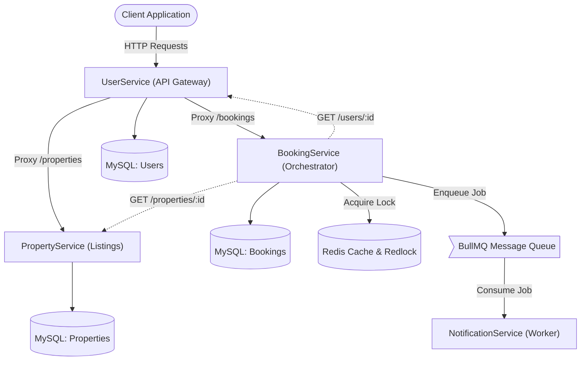

# Booking Orchestration Platform

A production-grade, distributed microservices architecture built to orchestrate high-concurrency booking workflows. The system is designed around four independently deployable services communicating over HTTP and Redis message queues, with strong guarantees around data consistency, race condition prevention, and end-to-end request traceability.

Built with Node.js, TypeScript, Express, Sequelize, Prisma, Redis (Redlock + BullMQ), and MySQL.

---

## High-Level Architecture



---

## How Concurrency Is Managed

One of the central design challenges in any booking platform is preventing two users from booking the same property for overlapping dates at the exact same time. This platform solves it using a two-phase strategy:

### Phase 1: Distributed Pessimistic Locking (Redlock)

When a booking request arrives, the `BookingService` constructs a deterministic lock resource string based on the property ID and the requested date range:

```
property:{propertyId}:{checkInDate}:{checkOutDate}
```

It then acquires a distributed lock on this resource using the **Redlock algorithm** across Redis. If a second concurrent request targets the same property and overlapping dates, it will be blocked at the lock acquisition layer and will fail gracefully with a conflict error.

### Phase 2: Double-Check After Lock

Even after acquiring the lock, the service performs a second database query (`getOverlappingBookings`) to verify that no confirmed booking was inserted in the gap between the initial check and the lock acquisition. This double-check pattern eliminates any remaining window for race conditions.

### Idempotency Keys (Preventing Double Submissions)

The booking flow is split into two steps: **create** and **confirm**. The create step returns a cryptographic `idempotencyKey`. The confirm step uses a database transaction with a `SELECT ... FOR UPDATE` (pessimistic row-level lock) on the idempotency key row. If the key is already marked as `finalized`, the request is rejected. This guarantees that even if a user double-clicks the confirm button, the booking is only finalized once.

---

## Service Breakdown

| Service | Port | ORM | Database | Role |
|---|---|---|---|---|
| **UserService** | 3000 | Sequelize | `airbnb_dev` | API Gateway, Authentication, Proxy |
| **BookingService** | 3001 | Prisma | `airbnb_booking_dev` | Reservations, Locking, Idempotency |
| **PropertyService** | 3002 | Sequelize | `airbnb_property_dev` | Property Listings, RBAC |
| **NotificationService** | 3004 | None | None | Async Email Worker (BullMQ) |

---

## Cross-Cutting Concerns

### Distributed Request Tracing

Every incoming request to the API Gateway is assigned a `correlationId` (UUID v4) via the `attachCorrelationMiddleware`. This ID is stored in Node.js `AsyncLocalStorage` and forwarded as an `x-correlation-id` header to every downstream service. When the `BookingService` enqueues an email job into BullMQ, the `correlationId` is embedded in the job payload. The `NotificationService` worker extracts it and re-mounts it into its own `AsyncLocalStorage` context, ensuring that every log line across every service for a single user action shares the same trace ID.

### Fail-Fast Environment Validation

All four services validate their environment variables at startup using `Zod` schemas. If a required variable (like `JWT_SECRET`, `DATABASE_URL`, or `MAILER_PASS`) is missing or malformed, the process exits immediately with a descriptive error rather than failing unpredictably at runtime.

### Standardized Error Handling

All services use a shared pattern of custom error classes (`BadRequestError`, `NotFoundError`, `UnauthorizedError`, `ConflictError`, `InternalServerError`) that extend a base `AppError` class. A centralized `genericErrorHandler` middleware at the bottom of each Express stack catches these errors and returns consistent JSON responses with appropriate HTTP status codes.

---

## Complete API Reference

All external traffic enters through the **UserService API Gateway** at `http://localhost:3000`. Interactive Swagger documentation is available at `http://localhost:3000/api-docs`.

### Authentication

| Method | Endpoint | Auth | Description |
|---|---|---|---|
| `POST` | `/api/v1/auth/register` | None | Register a new user account |
| `POST` | `/api/v1/auth/login` | None | Authenticate and receive a JWT |
| `GET` | `/api/v1/auth/profile` | Bearer JWT | Get the authenticated user's profile |
| `GET` | `/api/v1/auth/users/:id` | Internal | Fetch user by ID (used by downstream services) |

### Properties

| Method | Endpoint | Auth | Description |
|---|---|---|---|
| `GET` | `/api/v1/properties` | None | List all active properties |
| `GET` | `/api/v1/properties/:id` | None | Get a single property by ID |
| `POST` | `/api/v1/properties` | Bearer JWT (HOST/ADMIN) | Create a new property listing |

### Bookings

| Method | Endpoint | Auth | Description |
|---|---|---|---|
| `POST` | `/api/v1/bookings` | Bearer JWT | Create a booking (acquires lock, returns idempotencyKey) |
| `POST` | `/api/v1/bookings/confirm/:idempotencyKey` | Bearer JWT | Confirm a pending booking within an ACID transaction |
| `GET` | `/api/v1/bookings/:id` | Bearer JWT | Get a specific booking by ID |
| `GET` | `/api/v1/bookings/user/:userId` | Bearer JWT (Owner/ADMIN) | Get all bookings for a user |
| `POST` | `/api/v1/bookings/cancel/:id` | Bearer JWT (Owner/ADMIN) | Cancel a booking |

### Health Checks

| Method | Endpoint | Description |
|---|---|---|
| `GET` | `/api/v1/ping` | Gateway liveness probe |
| `GET` | `/health` | Gateway health check with uptime and timestamp |

---

## Running Locally

```bash
# Prerequisites: MySQL and Redis must be running locally.

# 1. Create databases
mysql -u root -e "CREATE DATABASE airbnb_dev; CREATE DATABASE airbnb_booking_dev; CREATE DATABASE airbnb_property_dev;"

# 2. Start each service (in separate terminals)
cd UserService && npm install && npm run dev
cd BookingService && npm install && npx prisma migrate dev && npm run dev
cd PropertyService && npm install && npm run dev
cd NotificationService && npm install && npm run dev
```

---

## Technology Stack

| Layer | Technology |
|---|---|
| Language | TypeScript (Node.js) |
| HTTP Framework | Express.js |
| ORM | Sequelize (User, Property), Prisma (Booking) |
| Database | MySQL |
| Cache / Queue | Redis |
| Distributed Lock | Redlock |
| Message Queue | BullMQ |
| Validation | Zod |
| Auth | JWT (jsonwebtoken) + bcrypt |
| Logging | Winston (daily rotate) |
| API Docs | Swagger (OpenAPI 3.0) |
