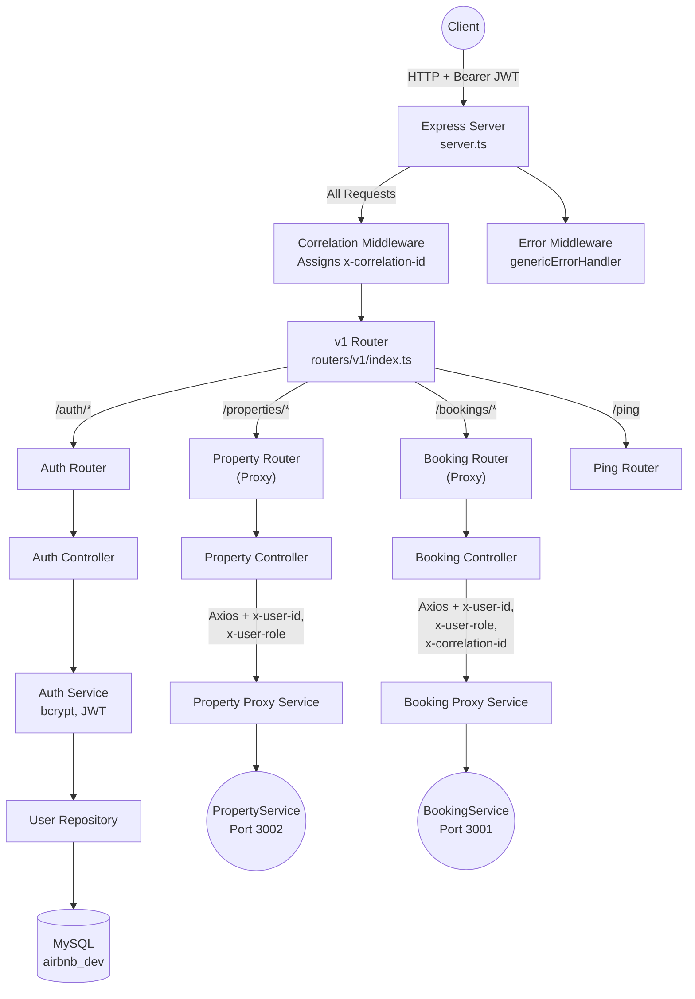

# User Service (API Gateway)

The User Service is the single point of entry for all external client traffic. It serves two roles: it owns user identity (registration, authentication, JWT issuance) and it acts as a reverse-proxy API Gateway, forwarding requests to downstream microservices with securely injected identity headers.

No downstream service is ever exposed to the public internet. All external requests flow through this gateway.

---

## Request Flow Architecture



---

## Folder Structure

```
UserService/
  src/
    config/            # Zod-validated env config, Sequelize setup, Winston logger
    controllers/       # HTTP request handlers (auth, booking proxy, property proxy, ping)
    db/
      migrations/      # Sequelize migration files
      models/          # Sequelize model definitions (User)
      seeders/         # Database seed scripts
    dto/               # TypeScript interfaces for request/response shapes
    middlewares/       # JWT auth, correlation ID injection, centralized error handler
    repositories/      # Data access layer (findUserByEmail, findUserById, createUser)
    routers/
      v1/              # Versioned route definitions
    services/          # Business logic (auth) and proxy services (booking, property)
    types/             # Shared TypeScript type declarations
    utils/
      errors/          # Custom error classes (AppError hierarchy)
      helpers/         # AsyncLocalStorage for correlationId
    validators/        # Zod schemas for request body validation
  swagger.json         # OpenAPI 3.0 specification
```

---

## SOLID Principles in Practice

- **Single Responsibility**: Controllers only parse HTTP input and format responses. Business logic lives in services. Database queries live in repositories. Each layer has exactly one reason to change.
- **Open/Closed**: The proxy pattern allows adding new downstream services (e.g., a PaymentService) by creating a new proxy service file and a new router, without modifying existing code.
- **Dependency Inversion**: Controllers depend on service interfaces, not on database details. The repository layer can be swapped from Sequelize to any ORM without touching controllers or services.

---

## Middleware Pipeline

Every request passes through the following middleware chain in order:

1. **Body Parsers** - `express.json()`, `express.text()`, `express.urlencoded()`
2. **Correlation Middleware** - Reads `x-correlation-id` from the incoming header or generates a new UUID. Stores it in `AsyncLocalStorage` so all downstream code (including logger) can access it without explicit parameter passing.
3. **Route-Level Auth** (`requireAuth`) - Applied selectively on protected routes. Extracts and verifies the Bearer JWT, then injects `req.userId` and `req.userRole` into the request object.
4. **Validation Middleware** (`validateRequestBody`) - Uses Zod schemas to validate the request body. Returns a 400 with structured error messages if validation fails.
5. **Error Handler** (`genericErrorHandler`) - Catches all errors thrown by upstream middleware/controllers. Maps `AppError` subclasses to the correct HTTP status codes. Returns a consistent JSON error envelope.

---

## API Reference

Base URL: `http://localhost:3000`

### Route Summary

**Authentication** (`/api/v1/auth`)

| Method | Endpoint | Auth | Description |
|---|---|---|---|
| `POST` | `/api/v1/auth/register` | None | Register a new user |
| `POST` | `/api/v1/auth/login` | None | Authenticate, receive JWT |
| `GET` | `/api/v1/auth/profile` | Bearer JWT | Get authenticated user's profile |
| `GET` | `/api/v1/auth/users/:id` | Internal | Fetch user by ID (used by downstream services) |

**Properties** (`/api/v1/properties`)

| Method | Endpoint | Auth | Description |
|---|---|---|---|
| `GET` | `/api/v1/properties` | None | List all property listings |
| `GET` | `/api/v1/properties/:id` | None | Get a single property by ID |
| `POST` | `/api/v1/properties` | Bearer JWT (HOST/ADMIN) | Create a new property listing |

**Bookings** (`/api/v1/bookings`)

| Method | Endpoint | Auth | Description |
|---|---|---|---|
| `POST` | `/api/v1/bookings` | Bearer JWT | Create a booking (acquires distributed lock) |
| `POST` | `/api/v1/bookings/confirm/:idempotencyKey` | Bearer JWT | Confirm a pending booking (ACID transaction) |
| `GET` | `/api/v1/bookings/:id` | Bearer JWT | Get a booking by ID |
| `GET` | `/api/v1/bookings/user/:userId` | Bearer JWT (Owner/ADMIN) | Get all bookings for a user |
| `POST` | `/api/v1/bookings/cancel/:id` | Bearer JWT (Owner/ADMIN) | Cancel a booking |

**Health**

| Method | Endpoint | Auth | Description |
|---|---|---|---|
| `GET` | `/ping` | None | Root-level liveness probe |
| `GET` | `/health` | None | Service health with uptime and timestamp |

---

### Authentication Routes (`/api/v1/auth`)

---

#### `POST /api/v1/auth/register`

Register a new user account. Passwords are hashed with bcrypt before storage. Email uniqueness is enforced at the service layer.

**Auth Required**: None

**Request Body**:
```json
{
  "email": "john@example.com",
  "password": "SecurePass1",
  "firstName": "John",
  "lastName": "Doe",
  "phone": "+1234567890",
  "role": "GUEST"
}
```

**Validation Rules** (Zod):
- `email`: Must be a valid email format
- `password`: Minimum 8 characters, must contain at least one lowercase, one uppercase, and one digit
- `firstName`, `lastName`: Required, non-empty
- `phone`: Optional
- `role`: One of `GUEST`, `HOST`, `ADMIN`. Defaults to `GUEST`

**Response** (`201 Created`):
```json
{
  "success": true,
  "message": "User registered successfully",
  "data": {
    "id": 1,
    "email": "john@example.com",
    "firstName": "John",
    "lastName": "Doe",
    "role": "GUEST",
    "createdAt": "2026-07-09T10:00:00.000Z",
    "updatedAt": "2026-07-09T10:00:00.000Z"
  }
}
```

---

#### `POST /api/v1/auth/login`

Authenticate with email and password. Returns a signed JWT containing `userId` and `role`.

**Auth Required**: None

**Request Body**:
```json
{
  "email": "john@example.com",
  "password": "SecurePass1"
}
```

**Response** (`200 OK`):
```json
{
  "success": true,
  "message": "Login successful",
  "data": {
    "token": "eyJhbGciOiJIUzI1NiIs...",
    "user": {
      "id": 1,
      "email": "john@example.com",
      "firstName": "John",
      "lastName": "Doe",
      "role": "GUEST"
    }
  }
}
```

---

#### `GET /api/v1/auth/profile`

Retrieve the profile of the currently authenticated user.

**Auth Required**: Bearer JWT

**Response** (`200 OK`):
```json
{
  "success": true,
  "message": "Profile retrieved successfully",
  "data": {
    "id": 1,
    "email": "john@example.com",
    "firstName": "John",
    "lastName": "Doe",
    "role": "GUEST"
  }
}
```

---

#### `GET /api/v1/auth/users/:id`

Internal endpoint consumed by the `BookingService` to hydrate user details (e.g., email address) before queuing notification jobs. Not intended for direct external client use.

**Auth Required**: None (internal trust boundary — called only by downstream services)

**Response** (`200 OK`):
```json
{
  "success": true,
  "message": "User found",
  "data": {
    "id": 1,
    "email": "john@example.com",
    "firstName": "John",
    "lastName": "Doe",
    "role": "GUEST"
  }
}
```

**Error Cases**:
- `404` - User not found

---

### Property Routes (`/api/v1/properties`)

All property routes are proxied to the internal `PropertyService` running on port 3002. The gateway injects `x-user-id` and `x-user-role` headers for authenticated routes.

---

#### `GET /api/v1/properties`

Fetch all active property listings.

**Auth Required**: None

---

#### `GET /api/v1/properties/:id`

Fetch a single property by its ID.

**Auth Required**: None

---

#### `POST /api/v1/properties`

Create a new property listing. The gateway injects the authenticated user's ID as `hostId` into the request body before proxying.

**Auth Required**: Bearer JWT (must have `HOST` or `ADMIN` role; enforced by PropertyService)

**Request Body**:
```json
{
  "name": "Oceanfront Villa",
  "description": "A beautiful villa on the beach",
  "address": "123 Beach Road",
  "city": "Miami",
  "country": "USA",
  "pricePerNight": 450.00,
  "maxGuests": 6
}
```

---

### Booking Routes (`/api/v1/bookings`)

All booking routes are proxied to the internal `BookingService` running on port 3001. The gateway injects `x-user-id`, `x-user-role`, and `x-correlation-id` headers on every proxied request. All booking routes require authentication.

---

#### `POST /api/v1/bookings`

Create a preliminary booking. Acquires a distributed lock on the property + date range and returns an `idempotencyKey` for the confirmation step.

**Auth Required**: Bearer JWT

**Request Body**:
```json
{
  "propertyId": 1,
  "totalGuests": 2,
  "bookingAmount": 900.00,
  "checkInDate": "2026-09-01T12:00:00Z",
  "checkOutDate": "2026-09-03T12:00:00Z"
}
```

---

#### `POST /api/v1/bookings/confirm/:idempotencyKey`

Confirm a pending booking using the idempotency key returned from the create step. Executes inside a database transaction with a row-level lock.

**Auth Required**: Bearer JWT

---

#### `GET /api/v1/bookings/:id`

Fetch a single booking by its ID.

**Auth Required**: Bearer JWT

---

#### `GET /api/v1/bookings/user/:userId`

Fetch all bookings for a specific user. Users can only access their own bookings. Admins can access any user's bookings.

**Auth Required**: Bearer JWT (Owner or ADMIN)

---

#### `POST /api/v1/bookings/cancel/:id`

Cancel an existing booking. Users can only cancel their own bookings. Admins can cancel any booking.

**Auth Required**: Bearer JWT (Owner or ADMIN)

---

### Health Check Routes

| Method | Endpoint | Auth | Description |
|---|---|---|---|
| `GET` | `/ping` | None | Root-level liveness probe (mounted outside `/api`) |
| `GET` | `/health` | None | Returns service name, process uptime, and UTC timestamp |

---

## Environment Variables

| Variable | Required | Default | Description |
|---|---|---|---|
| `PORT` | No | `3000` | Server port |
| `JWT_SECRET` | Yes | - | Secret key for signing JWTs |
| `JWT_EXPIRY` | No | `24h` | JWT expiration duration |
| `BCRYPT_SALT_ROUNDS` | No | `10` | bcrypt hashing rounds |
| `DB_HOST` | No | `localhost` | MySQL host |
| `DB_USER` | Yes | - | MySQL username |
| `DB_PASSWORD` | Yes | - | MySQL password |
| `DB_NAME` | Yes | - | MySQL database name |
